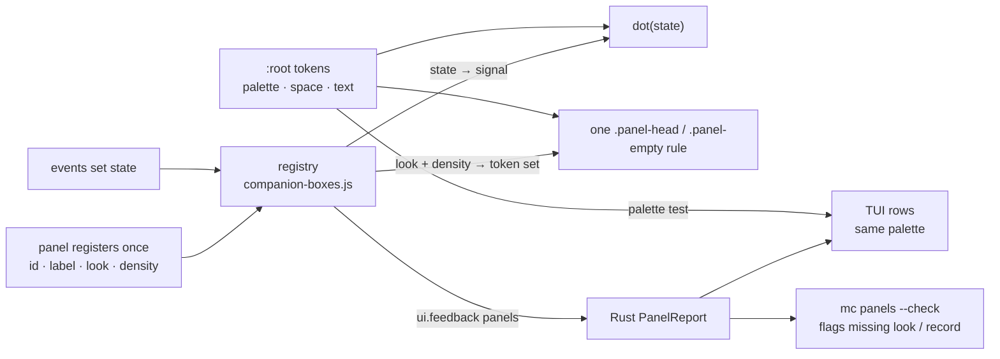

# Unified Panel Reporting Implementation Plan

> **For agentic workers:** Each task names its owner. Claim your paths in the Sam ledger before editing (single main checkout, serialized commits). Tests run only through the pre-commit hook. Steps use checkbox (`- [ ]`) syntax.

**Goal:** Every UI panel carries one standard record with a few flags, so the TUI and CLI read (and check) the whole UI generically: no per-switch commands, no DOM scraping, no per-panel Rust code.

**Architecture:** The shell's box registry (`companion-boxes.js`) becomes the panel registry: one record per panel, a revision that changes only when a flag changes, plus a list of unconfigured controls. That rides the existing `ui.feedback` payload (no new IPC, no new poller). The engine crate owns the typed Rust view (`panels.rs`), which `mc` (TUI + CLI) consumes. One `dot()` and one panel component render every panel, so the design locks with the reporting.

**Tech Stack:** Vanilla JS shell UI (node:vm tests in `apps/magicstudio-shell/tests/*.mjs`), Rust workspace (`magicstudio-engine`, `mc` with ratatui), Tauri shell bridge.

**Spec:** this document (the design was agreed in chat with Jesse on 2026-10-23).

## Agent brief (read this first, every session)

You are one of several agents in ONE shared checkout. This file is the contract.

- Do only your task number. Claim its paths in `design/coordination/handoff-ledger.md` (C35) before editing.
- Commit with `git commit --only <your paths>`. Never stage, revert, stash or merge files you did not write.
- Tests run only through `.githooks/pre-commit`. Write the failing test first; let the hook run it.
- Use the names in "The contract" and "The style contract" exactly. Do not invent fields, classes, tokens or commands.
- No per-panel or per-character logic: code loops over panels and looks.
- No silent fallbacks: a missing registry, look or Studio is reported, never drawn as a default.
- If the plan is wrong or a step fails, stop and report `file:line` to the coordinator (Claude, pane wG:pS). Do not improvise.
- Report each commit SHA to the coordinator in one line.



## Refactor as you go (every agent, every UI commit)

The design is locked by a ratchet, not by a big-bang rewrite. Any commit that touches a file under `apps/magicstudio-shell/ui/` also leaves that file closer to the contract:

- Every count in `tests/ui-lint.mjs` is tracked **per file** in `ui-lint.baseline.json`. A commit may never raise a file's count, and a commit that edits a file with a non-zero count must lower at least one of that file's counts (`--write-baseline` records the new floor in the same commit).
- Converting means using the contract, not inventing: a panel gets a `look` from the fixed list, sizes come from the scale tokens, colours from palette tokens, lights from `dot(state)`.
- Code that builds UI goes through `el()` with a `box`/`id` so it registers; `mc panels --check` must stay at 0 unconfigured for any view you touched.
- If a needed look, token or state is missing from the contract, stop and ask the coordinator; do not add a one-off.

## Who does what

| # | Owner | Delivers | Paths (claim in ledger) | Waits on |
|---|---|---|---|---|
| 1 | Rizzo | Boxes survive a project switch | `ui/companion-boxes.js`, `ui/companions.js`, `ui/app.js:224-230`, `tests/companions.mjs` | — |
| 2 | Beaker | Panel record + change-only revision + unconfigured list in `ui.feedback` | `ui/companion-boxes.js`, `ui/feedback.js`, `ui/bridge.js`, `tests/panels.mjs`, `.githooks/pre-commit` | 1 |
| 3 | Rizzo | Rust `panels` types; `studios.rs` on a `Studio` struct | `crates/engine/src/panels.rs`, `crates/engine/src/lib.rs`, `crates/engine/tests/panels.rs`, `apps/mc/src/studios.rs` | — |
| 4 | Rizzo | `mc panels [--json\|--check]`; generic `ui.panel` setter | `apps/mc/src/main.rs`, `apps/mc/src/panels.rs`, `apps/magicstudio-shell/src/bridge.rs` | 2, 3 |
| 5 | Gonzo | TUI panel rows + "Unconfigured UI" row, redraw on revision | `apps/mc/src/center/panels.rs` (new), `apps/mc/src/center.rs` | 3 |
| 6 | Rizzo | Per-pet timer + cooldown | `ui/companions.js`, `tests/companions.mjs` | 1 |
| 7 | Beaker | One `dot()`, one panel component, colour tokens, `ui-lint` baseline in the hook | `ui/style.css`, `ui/*.js` call sites, `tests/ui-lint.mjs`, `tests/ui-lint.baseline.json` | 2 |

| 8 | Beaker | Looks + density as token sets; one spacing/type scale; `look` in the panel record; TUI palette = UI palette | `ui/style.css`, `ui/companion-boxes.js`, `ui/app.js` panel builders, `tests/ui-lint.mjs`, `tests/panels.mjs`; palette test in `apps/mc/src/center.rs` tests (Gonzo reviews) | 7 |

`ui/` and `tests/` are under `apps/magicstudio-shell/`. Shared files (`companion-boxes.js`, `.githooks/pre-commit`) change in the order above, one owner at a time.

Companion plan: `docs/superpowers/plans/2026-10-23-magic-studio-wiring-refactor.md` (video project path). Its Task 3 reports wiring as a panel through this contract, so it starts after Task 2 here.

## The contract (all tasks code against this, verbatim)

`ui.feedback` gains one key, `panels`:

```json
"panels": {
  "revision": 12,
  "available": true,
  "items": [
    { "id": "block-song", "label": "Song", "signal": 1, "open": true, "busy": false, "dirty": false }
  ],
  "unconfigured": [ { "id": "button-17", "tag": "button", "label": "Export", "reason": "untracked" },
                    { "id": "block-song", "tag": "section", "label": "Song", "reason": "unknown-look" } ]
}
```

- `signal`: 0 idle · 1 green in use · 2 yellow attention · 3 red problem. The ONLY state→signal table is `SIGNAL` in `companion-boxes.js`. **`working` maps to 1 (in use) with `busy: true`**, not 2: yellow means "needs you", work in flight is the `busy` flag (drawn as the `pulse` variant).
- `dot(state, variant?)` takes the box **state string** (idle / working / ready / needs-attention / failed) and derives the signal from `SIGNAL`; callers never pass numbers or class names.
- `register(id, opts)` **extends** the existing signature (`project`, `context`, `priority`, `title` stay); `label` and `on: {open, busy, dirty}` are added.
- "Configured" = the element or an ancestor carries `data-box-id` (set by `el()` in `app.js`) for an id the registry knows.
- Flags: `open` (visible/expanded), `busy` (work in flight), `dirty` (unsaved edits). Default set chosen in chat; Jesse may change it. Adding a flag later = one field in JS + one field in `Panel`.
- `revision` increments only when an item's flags or the unconfigured list actually change. The 1 s feedback heartbeat must NOT bump it.
- `items` and `unconfigured` are each capped at 64.
- `reason` is one of: `untracked` (no registered panel above it), `no-look` (registered panel without a `look`), `unknown-look` (look not in the fixed list), `unstyled` (inline `style` attribute on a registered panel or its head/empty/status). The TUI and `mc panels` show a count per reason; this is the map of random, untracked and unstyled UI.
- No Studio / closed page → readers report `available: false`, never zero panels or invented failures.

Rust (`crates/engine/src/panels.rs`, `pub mod panels;` in lib.rs):

```rust
#[repr(u8)] pub enum Signal { Idle = 0, InUse = 1, Attention = 2, Problem = 3 }
impl Signal { pub fn from_u64(v: u64) -> Signal; pub fn label(self) -> &'static str; } // "idle" "in use" "attention" "problem"
#[derive(Deserialize, Serialize, Clone, Debug, PartialEq)]
pub struct Panel { pub id: String, pub label: Option<String>, pub signal: Signal, pub open: bool, pub busy: bool, pub dirty: bool }
pub enum Reason { Untracked, NoLook, UnknownLook, Unstyled } // serde kebab-case
pub struct Unconfigured { pub id: String, pub tag: String, pub label: Option<String>, pub reason: Reason }
pub struct PanelReport { pub revision: u64, pub available: bool, pub items: Vec<Panel>, pub unconfigured: Vec<Unconfigured> }
impl PanelReport { pub fn from_feedback(feedback: &serde_json::Value) -> PanelReport; pub fn worst(&self) -> Signal; pub fn count(&self, reason: Reason) -> usize; }
```

Generic setter (replaces per-switch commands): `ui.panel id=<panel> flag=<open|busy|dirty> value=<bool>` → shell `bridge.rs` routes to page `acBridge.panel(id, flag, value)` → calls the handler the panel registered for that flag; a flag without a handler is refused with `"panel <id> does not accept <flag>"`.

## The style contract (Task 8)

A panel's look is configuration, chosen once at registration from a fixed list. Values live only in `:root` tokens.

```js
companionBoxes.register("block-song", { label: "Song", look: "control", density: "normal" });
// el() writes data-look / data-density on the element; CSS reads tokens only.
```

| Kind | Looks (fixed list) | Replaces today's modifiers |
|---|---|---|
| head | `control` (clickable row) · `bar` (pane title with rule) · `ruler` (sticky timeline head) · `inline` (row inside a body) | `control`; `divided`+`spread`+`pane`; `tiny`; `inline` |
| empty | `card` · `overlay` · `inline` | `boxed`+`compare`; `overlay`+`motion`; `inline` |
| density | `normal` · `compact` | the 18 context overrides (`.blocks.collapsed …`, `.magic-chat-pane …`, `.magic-image-tools …`, the narrow media query) |

- Scale tokens in `:root`: `--space-1..5` = 4, 8, 12, 16, 28px; `--text-xs, -sm, -md, -lg, -xl` = 10, 11, 13, 15, 18px; existing `--radius`.
- Each look and density sets only panel tokens (`--panel-pad-y`, `--panel-pad-x`, `--panel-gap`, `--panel-text`, `--panel-rule`, `--panel-bg`). ONE `.panel-head` rule and ONE `.panel-empty` rule consume them.
- The panel record gains `look` (string). `unconfigured` also lists a registered panel whose `look` is missing or not in the list.
- One palette: the TUI signal colours come from the same values as `--signal-0..3`. Today they differ (UI green `#35e1c0`, TUI `#4fe88f`; amber `#f0a83c`/`#f6c168`; red `#e0524a`/`#ff7682`). Jesse picks which side wins; until then the UI tokens win.

### One universal stylesheet, components locked

`style.css` (899 lines today) splits into three layers, loaded in this order from `index.html`:

| File | Holds | May contain |
|---|---|---|
| `ui/tokens.css` | palette, `--signal-*`, scale (`--space-*`, `--text-*`, `--radius`), motion | the ONLY literal values (hex, px, ms) in the shell |
| `ui/components.css` | `.dot`, `.panel-head`, `.panel-empty`, `.panel-status`, buttons/chips, every `[data-look]` / `[data-density]` token set | `var(--…)` only; no literals |
| `ui/views.css` | page layout: grids, columns, where panels sit | layout properties on view containers; **no selector that names a component class** (`.panel-*`, `.dot`, …) |

- A view changes how a component looks only by choosing its `look`/`density` at registration, never by a CSS override. That is what "components lock it in" means, and `ui-lint.mjs` enforces it: literals outside `tokens.css`, and any `views.css` selector containing a component class, are counted (target 0).
- Rust `tui_signal_colours_match_ui_tokens` reads `ui/tokens.css`, so the TUI, the Studio and the pets share one palette file.

## Global Constraints

- No new IPC channel, no new poller (companions contract C13).
- Facts only from events; empty ≠ error; unavailable is explicit.
- No per-panel / per-character logic in Rust or tests: everything generic over `items`.
- Colours only as `:root` tokens; no hex outside `:root` in new or touched CSS.
- Pets: `pointer-events: none`, finite motion, nothing per-frame.

## Review Focus

- Feedback heartbeat (1 s) re-sends unchanged panels → `revision` must stay the same (JS test in Task 2).
- Project switch → registry must not silently empty (Rizzo's live finding); items re-register for the new project (Task 1 test).
- Two pets get news in the same tick → both bursts finish and both return to rest (Task 6 test).
- `ui.feedback` from an older Studio with no `panels` key → `available: false`, TUI shows "unavailable", not 0 (Task 3 test).
- Element inside a registered panel but itself without an id → configured (ancestor rule), not reported (Task 2 test).
- A Studio that is off → grey (idle), never red: off is not a failure (Task 7, `app.js` server dot, `index.html:30`).

---

### Task 1 (Rizzo): Box registry must survive project switch — prerequisite

**Files:** Modify `apps/magicstudio-shell/ui/companion-boxes.js`, `companions.js`, `app.js:224-230` (el() registration) as the cause dictates. Test: `apps/magicstudio-shell/tests/companions.mjs`.

- [ ] Write failing test `registry keeps boxes across project switch`: register `block-song` for project A, switch `state.project` to B, re-render (el() registers again), assert `snapshot({project: B})` contains `block-song`.
- [ ] Find the clearer (candidates: `clear()`, `markUnavailable()`, el() using a stale `state.project`), fix it, test passes.
- [ ] Commit `fix(ui): boxes survive a project switch (#23)`.

### Task 2 (Beaker): Panel record, change-only revision, unconfigured list

**Files:** Modify `apps/magicstudio-shell/ui/companion-boxes.js`, `apps/magicstudio-shell/ui/feedback.js:13-14`, `apps/magicstudio-shell/ui/bridge.js` (add `panel()`, reuse `CLICKABLE`). Create test `apps/magicstudio-shell/tests/panels.mjs`.

**Produces:** `companionBoxes.panels() -> {revision, available:true, items, unconfigured}`; `companionBoxes.register(id, {label, on: {open: fn, busy: fn, dirty: fn}})`; `companionBoxes.flag(id, name, value)`; `acBridge.panel(id, flag, value)`.

- [ ] Tests in `panels.mjs`: `panels() shape matches contract`; `revision unchanged when nothing changed` (call panels() twice, and flag() with the same value); `revision bumps once per real change`; `unconfigured lists clickable without data-box-id ancestor`; `child of registered panel is configured`; `panel() refuses flag with no handler` (exact message from the contract).
- [ ] Implement. Remove the registry methods that have no callers after this change (`fact`, `observe`, `resolve`, `markUnavailable` — grep first; keep any with a caller).
- [ ] `feedbackSnapshot()` sends `panels: companionBoxes.panels()` (keep `boxes` until Task 4 lands, then delete it).
- [ ] Add `node apps/magicstudio-shell/tests/panels.mjs` and `node apps/magicstudio-shell/tests/companions.mjs` to `.githooks/pre-commit` next to `agent-selection.mjs`.
- [ ] Commit `feat(ui): panels report flags and unconfigured controls through feedback (#23)`.

### Task 3 (Rizzo): Engine `panels` types + `Studio` struct

**Files:** Create `crates/engine/src/panels.rs`, `crates/engine/tests/panels.rs`; modify `crates/engine/src/lib.rs`; refactor `apps/mc/src/studios.rs` (behaviour unchanged).

**Produces:** the Rust types in the contract; `studios::Studio { endpoint, id, pid, project: Option<PathBuf>, view, ready, unsaved }` with `name()`, `confirm_command()`, `is_clean()`; `studios::Studios::discover() -> Studios { live: Vec<Studio>, errors: Vec<Value> }` with `find(&str)`, `pinned()`.

- [ ] Tests: `from_feedback_reads_contract_example` (the JSON above → 1 item, signal InUse, 2 unconfigured, `count(Untracked) == 1`, `count(UnknownLook) == 1`); `unknown_reason_string_is_untracked_not_panic`; `missing_panels_key_is_unavailable`; `signal_out_of_range_is_problem_not_panic` (signal 9 → Problem); `worst_of_empty_is_idle`.
- [ ] Implement with serde; `Signal` deserializes from the number.
- [ ] Refactor `studios.rs` onto `Studio`; `mc studios`, `--json`, `--check`, pin output byte-identical (existing tests stay green).
- [ ] Commit `feat(engine): typed panel report; mc studios reads typed Studios (#23)`.

### Task 4 (Rizzo): `mc panels` + generic `ui.panel` setter

**Consumes:** Task 2 `acBridge.panel`, Task 3 `PanelReport`.
**Files:** Modify `apps/mc/src/main.rs` (subcommand + SUBCOMMANDS + help), create `apps/mc/src/panels.rs`; modify `apps/magicstudio-shell/src/bridge.rs:93-96` (route `ui.panel` → `page(app, "panel", [id, flag, value])`), register `ui.panel` wherever `ui.set` is registered for MCP/command_list.

- [ ] `mc panels` prints `SIGNAL  ID  LABEL  LOOK  open busy dirty` rows + one line per non-zero reason (`untracked 3: ids…`); `--json` prints the `PanelReport`; `--check` exits 1 when `unconfigured` is non-empty or `available` is false, 0 otherwise. Help line in `mc help` + one README example.
- [ ] Rust unit tests on the formatter with a fixture `PanelReport` (no live Studio).
- [ ] Delete `boxes` from `feedbackSnapshot()` once nothing reads it (grep `"boxes"`).
- [ ] Commit `feat(cli): mc panels lists and checks every panel; ui.panel sets a flag (#23)`.

### Task 5 (Gonzo): TUI panels section

**Consumes:** Task 3 `PanelReport::from_feedback`, `Signal`.
**Files:** Create `apps/mc/src/center/panels.rs` (rendering, following the `center/booth.rs` / `center/workshop.rs` split from merge `3642935`); modify `apps/mc/src/center.rs` (keep the report in `refresh` at `:110`; colour via one `fn signal_color(Signal) -> Color` using the existing `GREEN/AMBER/RED/MUTED` constants at `:750`).

- [ ] Keep `PanelReport` + `last_panels_revision` on `Center`; rebuild panel lines only when `revision` differs (existing 1 s refresh stays).
- [ ] Render: one row per panel (dot glyph coloured by signal, label, flags), a "UI health" row with one count per reason (`untracked 3 · no look 1 · unstyled 2`, all-zero shows `all panels tracked and styled`), ids per reason in details (`D`), "Panels unavailable" when `available` is false.
- [ ] Tests in `center.rs` `feedback_tests`: `panels_unavailable_renders_unavailable`, `same_revision_does_not_rebuild`, `unconfigured_count_shown`.
- [ ] Commit `feat(tui): Booth shows every panel's flags and unconfigured UI (#23)`.

### Task 6 (Rizzo): Pets — per-pet timer and cooldown

**Files:** Modify `apps/magicstudio-shell/ui/companions.js:13-14,133-145`; test in `companions.mjs`.

- [ ] Tests: `both pets finish their bursts in the same tick` (both end at `rest`); `rapid flips within 1500 ms produce one burst` (count pose changes).
- [ ] Replace shared `timer`/`step` with per-pet `{timer, step, lastBurstAt}`; skip a burst when `now - lastBurstAt < 1500`.
- [ ] Commit `fix(ui): each pet keeps its own burst, with a cooldown (#23)`.

### Task 7 (Beaker): One indicator and one panel component; design lint

**Files:** Modify `apps/magicstudio-shell/ui/style.css`, `app.js`, `animation.js`, `image-prompt.js`, `timeline.js`, `home.js`, `agent.js`, `blender-placement.js`. Create `apps/magicstudio-shell/tests/ui-lint.mjs`, `apps/magicstudio-shell/tests/ui-lint.baseline.json`.

**Produces:** `dot(state, variant?)` is the only indicator builder; CSS `.dot[data-signal="0|1|2|3"]` + `[data-variant="pulse|ring|hollow"]` (shape only), size via `--dot-size`; tokens `--signal-0..3`, plus `--danger`, `--info`, `--surface-3` (for `#212631`) in `:root`. Panel component classes `.panel-head`, `.panel-empty`, `.panel-status` replace `.agent-head .block-head .magic-pane-head .motion-object-head .sb-head .song-section-head .theatre-head`, `.home-empty .magic-compare-empty .motion-empty .sb-empty .studio-empty .theatre-empty`, `.agent-status .magic-part-status .footer-status`; size/density differences become modifiers (`.panel-head.compact`), not new families. Duplicate rules (`.magic-pane-head` ×2, `.motion-object-head` ×2, `.sb-empty` ×4, `.agent-toggle` ×2) merge.

- [ ] `ui-lint.mjs` counts: hex literals outside `:root`; `class: 'dot ` / `className = \`dot` outside `companion-boxes.js`; retired class names in CSS/JS. Fails when any count exceeds `ui-lint.baseline.json`. Start baseline at today's counts; add to `.githooks/pre-commit`.
- [ ] Migrate family by family (dot → head → empty → status), lowering the baseline in the same commit each time. Visual check of each view with the live-window screenshot recipe before each commit.
- [ ] Final baseline: retired names 0, hand-built dots 0, hex outside `:root` 0.
- [ ] Commits `refactor(ui): one indicator …`, `refactor(ui): one panel head …`, etc. (#23).

### Task 8 (Beaker): Looks, density and one scale

**Consumes:** Task 7 (`.panel-head`, `.panel-empty`, tokens, `ui-lint`). **Files:** `ui/style.css` → split into `ui/tokens.css`, `ui/components.css`, `ui/views.css` (update `ui/index.html` links), `ui/companion-boxes.js` (`register` accepts `look`, `density`; `panels()` items carry `look`), `ui/app.js` (panel builders pass `look`), `tests/ui-lint.mjs` + baseline, `tests/panels.mjs`. Palette test: `apps/mc/src/center.rs` `feedback_tests` (coordinate with Gonzo, who owns that file).

- [ ] Tests: `panels.mjs` — `look is reported in panels()`; `unknown look is listed as unconfigured`; `missing look is listed as unconfigured`. `ui-lint.mjs` — new counts `raw_px_in_panel_rules` (today 69) and `context_overrides` (today 18), baseline today, target 0. Rust — `tui_signal_colours_match_ui_tokens` parses `apps/magicstudio-shell/ui/tokens.css` and compares with `signal_color(Signal::*)`.
- [ ] Split the stylesheet into the three layers first (pure move, no visual change; lint counts `literals_outside_tokens` and `component_selectors_in_views` with today's baseline). Then add the scale tokens; rewrite heads and empties as one rule each plus token sets per look/density; delete the merged modifiers and the context overrides; set `data-look`/`data-density` from `register()`.
- [ ] Set the TUI signal colours to the UI token values (one `fn signal_color`).
- [ ] Make the baseline per file and enforce the "Refactor as you go" ratchet in `ui-lint.mjs` (staged UI files with non-zero counts must lower one). Lower the baseline in the same commit; final: `raw_px_in_panel_rules` 0, `context_overrides` 0.
- [ ] Visual check of each view with the live-window screenshot recipe before each commit; Jesse judges the look.
- [ ] Commits `refactor(ui): panel looks are token sets (#23)`, `refactor(ui): one spacing and type scale (#23)`, `fix(tui): signal colours match the Studio (#23)`.

## Order

Task 1 → (Task 2 ∥ Task 3) → (Task 4 ∥ Task 5) → Task 6 any time after 1 → Task 7 after Task 2 (all of it touches `companion-boxes.js`/`app.js`, which Tasks 1 and 2 change first) → Task 8 after Task 7.
