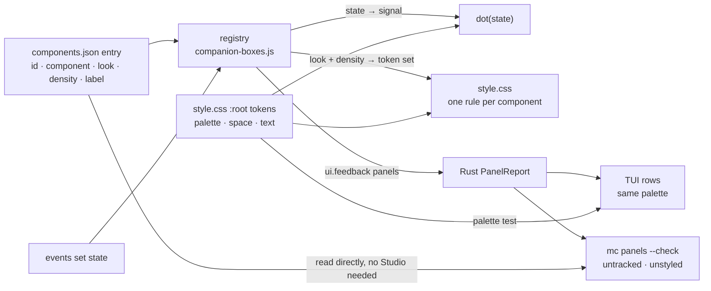

# Unified Panel Reporting Implementation Plan

> **For agentic workers:** Each task names its owner. Claim your paths in the Sam ledger before editing (single main checkout, serialized commits). Run the tests that match the change and report the real result. Steps use checkbox (`- [ ]`) syntax.

**Goal:** Every UI panel carries one standard record with a few flags, so the TUI and CLI read (and check) the whole UI generically: no per-switch commands, no DOM scraping, no per-panel Rust code.

**Architecture:** The shell's box registry (`companion-boxes.js`) becomes the panel registry: one record per panel, a revision that changes only when a flag changes, plus a list of unconfigured controls. That rides the existing `ui.feedback` payload (no new IPC, no new poller). The engine crate owns the typed Rust view (`panels.rs`), which `mc` (TUI + CLI) consumes. One `dot()` and one panel component render every panel, so the design locks with the reporting.

**Tech Stack:** Vanilla JS shell UI (node:vm tests in `apps/magicstudio-shell/tests/*.mjs`), Rust workspace (`magicstudio-engine`, `mc` with ratatui), Tauri shell bridge.

**Spec:** this document (the design was agreed in chat with Jesse on 2026-10-23).

## Definition of done (Jesse returns to real work when all are true)

1. `components.json` is the one config file; `mc panels` and the TUI read it **directly from disk** (no Studio needed) and list every element with its component and look.
2. A running Studio adds only live state per element: `signal` (0-3) and `busy`. `open` and `dirty` are **dropped** from the record until something needs them; if an element should start collapsed or hidden, that becomes a field in its config entry, not JS logic.
3. TUI "UI health" row shows `untracked` / `unstyled` counts, both 0 for every view.
4. `ui-lint --report` totals below the pre-refactor commit `08529bf` (CSS lines, selectors), px/hex only in `:root`, 0 inline style writes.
5. TUI colours come from one theme read from `style.css` `:root`.
6. Statler's Words panel is on main, on the contract.
7. The app builds and the coordinator has screenshotted Project, Animation and Design views from a fresh build.

Out of scope until then: new features, the probe rig, OpenDesign.

## Agent brief (read this first, every session)

You are one of several agents in ONE shared checkout. This file is the contract.

- Do only your task number. Claim its paths in `design/coordination/handoff-ledger.md` (C35) before editing.
- Commit with `git commit --only <your paths>`. Never stage, revert, stash or merge files you did not write.
- Write the failing test first, then run it and report the real result.
- Use the names in "The contract" and "The style contract" exactly. Do not invent fields, classes, tokens or commands.
- No per-panel or per-character logic: code loops over panels and looks.
- No silent fallbacks: a missing registry, look or Studio is reported, never drawn as a default.
- If the plan is wrong or a step fails, stop and report `file:line` to the coordinator (Claude, pane wG:pS). Do not improvise.
- Run the test that matches the change and report the real command and result. Do not claim an unrun check passed.
- Report each commit SHA to the coordinator in one line.



## Refactor as you go (every agent, every UI commit)

The design is locked by a ratchet, not by a big-bang rewrite. Any commit that touches a file under `apps/magicstudio-shell/ui/` also leaves that file closer to the contract:

- Every count in `tests/ui-lint.mjs` is tracked **per file** in `ui-lint.baseline.json`. A commit may never raise a file's count, and a commit that edits a file with a non-zero count must lower at least one of that file's counts (`--write-baseline` records the new floor in the same commit).
- Converting means using the contract, not inventing: the element gets an entry in `components.json` with a `look` from the fixed list, sizes come from the scale tokens, colours from palette tokens, lights from `dot(state)`, data geometry from custom properties. No inline styling.
- Code that builds UI goes through `el()` with a `box`/`id` so it registers; `mc panels --check` must stay at 0 unconfigured for any view you touched.
- **When a component comes out generic, give it a new look** (Jesse's rule): add a named look to that component's list in `components.json` and its token set inside the component's one rule in `style.css`, reusing `:root` tokens. No need to stop and ask for that. Never accept a plain default and never write a one-off class.
- A new **component**, **token** or **state** still goes through the coordinator, so it is added once, for everyone.

## Who does what

| # | Owner | Delivers | Paths (claim in ledger) | Waits on |
|---|---|---|---|---|
| 1 | Rizzo | Boxes survive a project switch | `ui/companion-boxes.js`, `ui/companions.js`, `ui/app.js:224-230`, `tests/companions.mjs` | — |
| 2 | Beaker | Panel record + change-only revision + unconfigured list in `ui.feedback` | `ui/companion-boxes.js`, `ui/feedback.js`, `ui/bridge.js`, `tests/panels.mjs` | 1 |
| 3 | Rizzo | Rust `panels` types; `studios.rs` on a `Studio` struct | `crates/engine/src/panels.rs`, `crates/engine/src/lib.rs`, `crates/engine/tests/panels.rs`, `apps/mc/src/studios.rs` | — |
| 4 | Rizzo | `mc panels [--json\|--check]` reading `components.json` from disk | `apps/mc/src/main.rs`, `apps/mc/src/panels.rs`, `apps/magicstudio-shell/src/bridge.rs` | 2, 3 |
| 5 | Gonzo | TUI panel rows + "Unconfigured UI" row, redraw on revision | `apps/mc/src/center/panels.rs` (new), `apps/mc/src/center.rs` | 3 |
| 6 | Rizzo | Per-pet timer + cooldown | `ui/companions.js`, `tests/companions.mjs` | 1 |
| 7 | Beaker | One `dot()`, one panel component, colour tokens, `ui-lint` baseline | `ui/style.css`, `ui/*.js` call sites, `tests/ui-lint.mjs`, `tests/ui-lint.baseline.json` | 2 |

| 8 | Beaker | `components.json` (one entry per element) + one `style.css`; no inline styling; looks/density as token sets | `ui/components.json`, `ui/style.css`, `ui/app.js` `el()`, inline-style sites, `tests/ui-lint.mjs`, `tests/panels.mjs` | 7 |
| 9 | Gonzo | TUI theme: colours and styles only in `theme.rs`, palette read from `style.css` | `apps/mc/src/theme.rs` (new), `apps/mc/src/center*.rs`, `apps/mc/src/logo.rs` | 5, 8 |
| 10 | Statler | Words / lyrics (Design > Words, Song sub-sections) onto the contract; land unmerged `5c4be84`, `550162d` | `ui/words.js`, Song region of `ui/app.js`, Design tab in `ui/index.html`, `crates/engine/src/words.rs` | 8 (UI part) |

`ui/` and `tests/` are under `apps/magicstudio-shell/`. Shared files (`companion-boxes.js`) change in the order above, one owner at a time.

Companion plan: `docs/superpowers/plans/2026-10-23-magic-studio-wiring-refactor.md` (video project path). Its Task 3 reports wiring as a panel through this contract, so it starts after Task 2 here.

## The contract (all tasks code against this, verbatim)

`ui.feedback` gains one key, `panels`:

```json
"panels": {
  "revision": 12,
  "available": true,
  "items": [
    { "id": "block-song", "label": "Song", "look": "control", "signal": 1, "busy": false }
  ],
  "unconfigured": [ { "id": "button-17", "tag": "button", "label": "Export", "reason": "untracked" },
                    { "id": "blender-placement", "tag": "div", "label": "Place in scene", "reason": "unstyled" } ]
}
```

- `signal`: 0 idle · 1 green in use · 2 yellow attention · 3 red problem. The ONLY state→signal table is `SIGNAL` in `companion-boxes.js`. **`working` maps to 1 (in use) with `busy: true`**, not 2: yellow means "needs you", work in flight is the `busy` flag (drawn as the `pulse` variant).
- `dot(state, variant?)` takes the box **state string** (idle / working / ready / needs-attention / failed) and derives the signal from `SIGNAL`; callers never pass numbers or class names.
- `register(id, opts)` **extends** the existing signature (`project`, `context`, `priority`, `title` stay); `label`, `look`, `density` are added (no `on` handlers).
- "Configured" = the element or an ancestor carries `data-box-id` (set by `el()` in `app.js`) for an id the registry knows.
- Live state is only `signal` and `busy` (work in flight). `open`/`dirty` are dropped (see Definition of done). Default set chosen in chat; Jesse may change it. Adding a flag later = one field in JS + one field in `Panel`.
- `revision` increments only when an item's flags or the unconfigured list actually change. The 1 s feedback heartbeat must NOT bump it.
- `items` and `unconfigured` are each capped at 64.
- `reason` is one of: `untracked` (no entry in `components.json` for it or an ancestor), `unstyled` (a visual inline style on it). Look validity is checked at commit time against `components.json`, not at runtime. The TUI and `mc panels` show a count per reason; this is the map of random, untracked and unstyled UI.
- No Studio / closed page → readers report `available: false`, never zero panels or invented failures.

Rust (`crates/engine/src/panels.rs`, `pub mod panels;` in lib.rs):

```rust
#[repr(u8)] pub enum Signal { Idle = 0, InUse = 1, Attention = 2, Problem = 3 }
impl Signal { pub fn from_u64(v: u64) -> Signal; pub fn label(self) -> &'static str; } // "idle" "in use" "attention" "problem"
#[derive(Deserialize, Serialize, Clone, Debug, PartialEq)]
pub struct Panel { pub id: String, pub label: Option<String>, pub look: Option<String>, pub signal: Signal, pub busy: bool }
// Static side: magicstudio_engine::panels::Config::load(path) reads ui/components.json (elements, looks, densities); mc panels and the TUI use it with or without a Studio.
pub enum Reason { Untracked, Unstyled } // serde kebab-case
pub struct Unconfigured { pub id: String, pub tag: String, pub label: Option<String>, pub reason: Reason }
pub struct PanelReport { pub revision: u64, pub available: bool, pub items: Vec<Panel>, pub unconfigured: Vec<Unconfigured> }
impl PanelReport { pub fn from_feedback(feedback: &serde_json::Value) -> PanelReport; pub fn worst(&self) -> Signal; pub fn count(&self, reason: Reason) -> usize; }
```

No setter command: nothing switches a panel from outside. Removed with `open`/`dirty` (Definition of done). Beaker deletes `flag()`, `on` handlers and `magicBridge.panel()` in Task 8 with their tests.

## The style contract (Task 8): two files

The Studio window is a web page (Tauri webview), so style works exactly as on the web: an element gets its look from the classes its component gives it, and the cascade does the rest. **Two files hold all of it.**

| File | Holds | Rule |
|---|---|---|
| `apps/magicstudio-shell/ui/components.json` | one entry per UI element id: `{ "component": "panel", "look": "control", "density": "normal", "label": "Song" }` | every element `el()` builds with an id or `box` must have an entry; `el()` reads the entry and sets `class`, `data-look`, `data-density` from it |
| `apps/magicstudio-shell/ui/style.css` | `:root` tokens at the top (palette, `--signal-*`, `--space-1..5` = 4/8/12/16/28px, `--text-xs..xl` = 10/11/13/15/18px, `--radius`, motion), then one block per component | literal values (hex, px, ms) only inside `:root`; component rules use `var()` only; a component's looks and densities set only its own tokens; no rule styles a component from the outside (no `.some-view .panel-head`) |

Views are components too (`workspace`, `storyboard`, `timeline`, …): their layout is their component rule, with their own entry in `components.json`.

New looks are cheap and expected: when a component looks generic somewhere, add a named look (tokens only) rather than accept a default or write an override.

```json
{
  "version": 1,
  "looks": { "panel-head": ["control", "bar", "ruler", "inline"], "panel-empty": ["card", "overlay", "inline"] },
  "densities": ["normal", "compact"],
  "elements": {
    "block-song":        { "component": "panel-head", "look": "control", "density": "normal", "label": "Song" },
    "magic-chat-pane":   { "component": "panel-head", "look": "bar",     "density": "compact", "label": "Sproket chat" },
    "theatre-ruler":     { "component": "panel-head", "look": "ruler",   "label": "Timeline" },
    "sb-empty":          { "component": "panel-empty", "look": "card",   "label": "No storyboard yet" }
  }
}
```

**No inline styling.** No `style=` attribute and no `node.style.x =` for visual properties. Geometry that comes from project data (a placement's x/y/w/h, a clip's start, a splitter width, a pet's position) is set only as CSS custom properties (`node.style.setProperty("--x", …)`), and the component rule turns them into `left`/`top`/`width`/`transform`. Today: about 14 inline visual styles to remove (`blender-placement.js` ×5, `blender.js` cssText, `agent.js` pointer-events/cursor, `sequence.js` display/opacity/background, `companions.js` pointer-events) and about 20 geometry writes to move to custom properties (`app.js` storyboard placements, `timeline.js` clip positions, `agent.js` widths, `sequence.js`, `companions.js` transform).

**What the TUI and CLI get from this.** `mc` reads `components.json` directly, so it knows every element that should exist even with no Studio running. With a Studio running, the panel report is compared against it:

- `untracked`: on screen, no entry in `components.json`.
- `unstyled`: an element with a visual inline style.
- `no-look` / `unknown-look` are no longer runtime reasons: `tests/panels.mjs` validates `components.json` at commit time (every entry's look is in `looks`, every density in `densities`).

The panel record carries `look` from the entry. The TUI signal colours come from the `:root` values in `style.css` (palette test, Gonzo).

## Global Constraints

- No new IPC channel, no new poller (companions contract C13).
- Facts only from events; empty ≠ error; unavailable is explicit.
- No per-panel / per-character logic in Rust or tests: everything generic over `items`.
- Colours only as `:root` tokens; no hex outside `:root` in new or touched CSS.
- Pets: `pointer-events: none`, finite motion, nothing per-frame.

## Review Focus

- Feedback heartbeat (1 s) re-sends unchanged panels → `revision` must stay the same (JS test in Task 2).
- Project switch → registry must not silently empty (Rizzo's live finding); items re-register for the new project (Task 1 test).
- Two pets get news in the same tick → both bursts finish and both return to rest (Task 6 test).
- `ui.feedback` from an older Studio with no `panels` key → `available: false`, TUI shows "unavailable", not 0 (Task 3 test).
- Element inside a registered panel but itself without an id → configured (ancestor rule), not reported (Task 2 test).
- A Studio that is off → grey (idle), never red: off is not a failure (Task 7, `app.js` server dot, `index.html:30`).

---

### Task 1 (Rizzo): Box registry must survive project switch — prerequisite

**Files:** Modify `apps/magicstudio-shell/ui/companion-boxes.js`, `companions.js`, `app.js:224-230` (el() registration) as the cause dictates. Test: `apps/magicstudio-shell/tests/companions.mjs`.

- [ ] Write failing test `registry keeps boxes across project switch`: register `block-song` for project A, switch `state.project` to B, re-render (el() registers again), assert `snapshot({project: B})` contains `block-song`.
- [ ] Find the clearer (candidates: `clear()`, `markUnavailable()`, el() using a stale `state.project`), fix it, test passes.
- [ ] Commit `fix(ui): boxes survive a project switch (#23)`.

### Task 2 (Beaker): Panel record, change-only revision, unconfigured list

**Files:** Modify `apps/magicstudio-shell/ui/companion-boxes.js`, `apps/magicstudio-shell/ui/feedback.js:13-14`, `apps/magicstudio-shell/ui/bridge.js` (add `panel()`, reuse `CLICKABLE`). Create test `apps/magicstudio-shell/tests/panels.mjs`.

**Produces:** `companionBoxes.panels() -> {revision, available:true, items, unconfigured}`; `companionBoxes.register(id, {label, on: {open: fn, busy: fn, dirty: fn}})`; `companionBoxes.flag(id, name, value)`; `magicBridge.panel(id, flag, value)`.

- [ ] Tests in `panels.mjs`: `panels() shape matches contract`; `revision unchanged when nothing changed` (call panels() twice, and flag() with the same value); `revision bumps once per real change`; `unconfigured lists clickable without data-box-id ancestor`; `child of registered panel is configured`; `panel() refuses flag with no handler` (exact message from the contract).
- [ ] Implement. Remove the registry methods that have no callers after this change (`fact`, `observe`, `resolve`, `markUnavailable` — grep first; keep any with a caller).
- [ ] `feedbackSnapshot()` sends `panels: companionBoxes.panels()` (keep `boxes` until Task 4 lands, then delete it).
- [ ] Run `node apps/magicstudio-shell/tests/panels.mjs` and `node apps/magicstudio-shell/tests/companions.mjs` and report the real result.
- [ ] Commit `feat(ui): panels report flags and unconfigured controls through feedback (#23)`.

### Task 3 (Rizzo): Engine `panels` types + `Studio` struct

**Files:** Create `crates/engine/src/panels.rs`, `crates/engine/tests/panels.rs`; modify `crates/engine/src/lib.rs`; refactor `apps/mc/src/studios.rs` (behaviour unchanged).

**Produces:** the Rust types in the contract; `studios::Studio { endpoint, id, pid, project: Option<PathBuf>, view, ready, unsaved }` with `name()`, `confirm_command()`, `is_clean()`; `studios::Studios::discover() -> Studios { live: Vec<Studio>, errors: Vec<Value> }` with `find(&str)`, `pinned()`.

- [ ] Tests: `from_feedback_reads_contract_example` (the JSON above → 1 item, signal InUse, 2 unconfigured, `count(Untracked) == 1`, `count(Unstyled) == 1`); `unknown_reason_string_is_untracked_not_panic`; `missing_panels_key_is_unavailable`; `signal_out_of_range_is_problem_not_panic` (signal 9 → Problem); `worst_of_empty_is_idle`.
- [ ] Implement with serde; `Signal` deserializes from the number.
- [ ] Refactor `studios.rs` onto `Studio`; `mc studios`, `--json`, `--check`, pin output byte-identical (existing tests stay green).
- [ ] Commit `feat(engine): typed panel report; mc studios reads typed Studios (#23)`.

### Task 4 (Rizzo): `mc panels` reads the config file

**Consumes:** Task 3 `PanelReport` and `Config::load`.
**Files:** Modify `apps/mc/src/main.rs` (subcommand + SUBCOMMANDS + help), create `apps/mc/src/panels.rs`. No shell/bridge change.

- [ ] `mc panels` reads `ui/components.json` from disk (works with no Studio) and prints `SIGNAL  ID  COMPONENT  LOOK  LABEL  BUSY` rows (signal/busy `-` when no Studio answers) + one line per non-zero reason (`untracked 3: ids…`); `--json` prints the `PanelReport`; `--check` exits 1 when `unconfigured` is non-empty or `available` is false, 0 otherwise. Help line in `mc help` + one README example.
- [ ] Rust unit tests on the formatter with a fixture `PanelReport` (no live Studio).
- [ ] Delete `boxes` from `feedbackSnapshot()` once nothing reads it (grep `"boxes"`).
- [ ] `--check` exits 1 when any `untracked`/`unstyled` is reported or an entry's look is not in `looks`; 0 otherwise.
- [ ] Commit `feat(cli): mc panels reads the UI config and checks it (#23)`.

### Task 5 (Gonzo): TUI panels section

**Consumes:** Task 3 `PanelReport::from_feedback`, `Signal`.
**Files:** Create `apps/mc/src/center/panels.rs` (rendering, following the `center/booth.rs` / `center/workshop.rs` split from merge `3642935`); modify `apps/mc/src/center.rs` (keep the report in `refresh` at `:110`; colour via one `fn signal_color(Signal) -> Color` using the existing `GREEN/AMBER/RED/MUTED` constants at `:750`).

- [ ] Keep `PanelReport` + `last_panels_revision` on `Center`; rebuild panel lines only when `revision` differs (existing 1 s refresh stays).
- [ ] Render: one row per panel (dot glyph coloured by signal, label, flags), a "UI health" row with one count per reason (`untracked 3 · unstyled 2`, all-zero shows `every element tracked and styled`), ids per reason in details (`D`), "Panels unavailable" when `available` is false.
- [ ] Tests in `center.rs` `feedback_tests`: `panels_unavailable_renders_unavailable`, `same_revision_does_not_rebuild`, `unconfigured_count_shown`.
- [ ] Commit `feat(tui): Booth shows every panel's flags and unconfigured UI (#23)`.

### Task 6 (Rizzo): Pets — per-pet timer and cooldown

**Files:** Modify `apps/magicstudio-shell/ui/companions.js:13-14,133-145`; test in `companions.mjs`.

- [ ] Tests: `both pets finish their bursts in the same tick` (both end at `rest`); `rapid flips within 1500 ms produce one burst` (count pose changes).
- [ ] Replace shared `timer`/`step` with per-pet `{timer, step, lastBurstAt}`; skip a burst when `now - lastBurstAt < 1500`.
- [ ] Commit `fix(ui): each pet keeps its own burst, with a cooldown (#23)`.

### Task 7 (Beaker): One indicator and one panel component; design lint

**Files:** Modify `apps/magicstudio-shell/ui/style.css`, `app.js`, `animation.js`, `image-prompt.js`, `timeline.js`, `home.js`, `agent.js`, `blender-placement.js`. Create `apps/magicstudio-shell/tests/ui-lint.mjs`, `apps/magicstudio-shell/tests/ui-lint.baseline.json`.

**Produces:** `dot(state, variant?)` is the only indicator builder; CSS `.dot[data-signal="0|1|2|3"]` + `[data-variant="pulse|ring|hollow"]` (shape only), size via `--dot-size`; tokens `--signal-0..3`, plus `--danger`, `--info`, `--surface-3` (for `#212631`) in `:root`. Panel component classes `.panel-head`, `.panel-empty`, `.panel-status` replace `.agent-head .block-head .magic-pane-head .motion-object-head .sb-head .song-section-head .theatre-head`, `.home-empty .magic-compare-empty .motion-empty .sb-empty .studio-empty .theatre-empty`, `.agent-status .magic-part-status .footer-status`; size/density differences become modifiers (`.panel-head.compact`), not new families. Duplicate rules (`.magic-pane-head` ×2, `.motion-object-head` ×2, `.sb-empty` ×4, `.agent-toggle` ×2) merge.

- [ ] `ui-lint.mjs` counts: hex literals outside `:root`; `class: 'dot ` / `className = \`dot` outside `companion-boxes.js`; retired class names in CSS/JS. Fails when any count exceeds `ui-lint.baseline.json`. Start baseline at today's counts.
- [ ] Migrate family by family (dot → head → empty → status), lowering the baseline in the same commit each time. Visual check of each view with the live-window screenshot recipe before each commit.
- [ ] Final baseline: retired names 0, hand-built dots 0, hex outside `:root` 0.
- [ ] Commits `refactor(ui): one indicator …`, `refactor(ui): one panel head …`, etc. (#23).

### Task 8 (Beaker): components.json + one stylesheet, no inline styling

**Acceptance (measured, not claimed).** `node tests/ui-lint.mjs --report` prints, for `ui/style.css` and `ui/*.js`: CSS lines, rules, selectors, class names, px literals, hex literals, JS lines, inline style writes, `el()` style attributes. Task 8 is accepted only if, against the pre-refactor commit `08529bf` (CSS 869 lines / 671 rules / 673 selectors / 282 classes / 967 px / 72 hex; JS 3983 lines; 33 `.style.x =` + 14 `style:` attributes):

- CSS lines and selectors are **lower** than at `08529bf` (round 1 left them at 899 / 664, i.e. +30 lines);
- px and hex literals appear **only in `:root`**;
- `style:` attributes are 0 and `.style.x =` writes are 0 (geometry uses `style.setProperty("--x", …)`);
- UI JS lines are not higher than at `08529bf` (4005 today).

Each Task 8 commit message ends with the `--report` line before → after.

**Re-based bar (2026-10-23 23:40, after Statler's Words port 3a1c433 added +42 CSS lines / ~35 rules / +244 JS lines of new feature):** Task 8 is done when `ui-lint --report` shows CSS ≤ **911** lines and ≤ **673** selectors, UI JS ≤ **4227** lines, px and hex only in `:root`, and **0** `.style.x =` / **0** `style:` attributes. Measured at HEAD 73555d1c: 955 / 703 / 4289 / 923 px outside `:root` / 24 / 9.

**Consumes:** Task 7 (`.panel-head`, `.panel-empty`, tokens, `ui-lint`). **Files:** `ui/components.json` (new), `ui/style.css`, `ui/app.js` (`el()` reads the entry), `ui/companion-boxes.js` (items carry `look`; unconfigured `reason`), the ~34 inline-style sites listed above, `tests/ui-lint.mjs` + baseline, `tests/panels.mjs`. Palette test: Task 9. No `tokens.css` / `components.css` / `views.css`.

- [ ] Tests: `panels.mjs` — `every components.json look is in looks`; `every density is in densities`; `el() applies class and data-look from the entry`; `element without an entry is untracked`; `visual inline style is unstyled`; `geometry custom properties are not unstyled`. `ui-lint.mjs` new counts, per file: `inline_visual_styles` (≈14), `geometry_without_custom_property` (≈20), `raw_px_in_component_rules` (69), `outside_in_overrides` (18). Baseline today; target 0.
- [ ] Write `components.json` for the elements `el()` already registers; make `el()` read it.
- [ ] Rewrite panel looks/densities as token sets read by one rule per component; delete merged modifiers and outside-in overrides; add the scale tokens.
- [ ] Remove inline visual styles (move to the component rule); move data geometry to `--x/--y/--w/--h` custom properties.
- [ ] Per-file ratchet in `ui-lint.mjs` ("Refactor as you go"), plus `--report` for the acceptance numbers. Lower the baseline in each commit; final counts 0.
- [ ] After each commit report the SHA; the coordinator screenshots the live Studio for Jesse.
- [ ] Commits: `feat(ui): one config entry per element (#23)`, `refactor(ui): panel looks are token sets (#23)`, `refactor(ui): no inline styling; geometry through custom properties (#23)`.

### Task 9 (Gonzo): TUI theme, no inline styling in Rust

The TUI is the Rust side's UI and has the same problem: 31 `Color::Rgb(…)` literals (29 different colours) and 57 `Style::default()…` chains written at call sites, 44 of them in `apps/mc/src/center.rs`.

**Consumes:** Task 5, Task 8 (`style.css` `:root`). **Files:** create `apps/mc/src/theme.rs`; modify `apps/mc/src/center.rs`, `apps/mc/src/center/*.rs`, `apps/mc/src/logo.rs`.

**Produces:** `theme::signal(Signal) -> Style`, `theme::text() / muted() / accent() / title(active: bool) / panel_border(active: bool) / selected() -> Style` (exact set decided by what the call sites need; no per-screen functions). Colours are read once from the `:root` palette of `apps/magicstudio-shell/ui/style.css` via `include_str!` at build time, so the TUI and the Studio share one palette file.

- [ ] Tests (the palette test moves here from Task 8): `tui_signal_colours_match_ui_tokens`; `every_theme_style_has_a_colour` (no `Color::Reset` fallbacks).
- [ ] Replace call-site colours and `Style::default()` chains with theme functions.
- [ ] Acceptance: `Color::Rgb` and `Style::default()` appear only in `theme.rs` (`grep -rc` over `apps/mc/src`), and `apps/mc/src` total lines are lower than before the task. Commit message ends with the counts before → after.
- [ ] Commit `refactor(tui): one theme, read from the Studio palette (#23)`.

### Task 10 (Statler): Words / lyrics onto the panel architecture

**State on 2026-10-23 (checked by patch content, not SHA):** branch `feature/song-lyrics-reader` (worktree `.worktrees/song-lyrics-reader`, tip `550162d`, 63 commits behind main).

| Commit | What | In main? |
|---|---|---|
| `9559ef1` | artist's lyric sheet and song controls in the Song section | **yes**, as `17668a1` |
| `3fc6a0d` | Words lyric animations composed as HyperFrames tracks | **yes**, as `6ddc530` |
| `5c4be84` | Design > Words panel (`ui/words.js` 234 lines, 42-line CSS block, Design tab in `index.html`, `app.js` +1) **and** `words.rs` `timing_disagreements` (reference vs measured > 0.5 s) | **no** |
| `550162d` | Words view controls out of the unsaved-edit guard (`words.js` only) | **no** |

The unmerged UI predates the contract and would fail `ui-lint` as is: 3 hex + 55 px outside `:root`, own `.design-*` classes, 5 inline style writes in `words.js`, 2 hand-built dots, no panel registration. That is expected, not a defect; it is good work written before the rules.

Statler keeps ownership of its code. Nobody else rewrites `songSection()`, `lyricModel`/`lyricSheet`/`lyricsBody`, `words.js` or the Design tab.

**Consumes:** Task 8's first commit (`components.json` + `el()` reading it). **Files:** Statler's: `ui/words.js`, the Song/Words region of `ui/app.js` (`songSection()`, lyric model/sheet/body), the Design tab in `ui/index.html`, `crates/engine/src/words.rs`; entries in `ui/components.json`; component rules in `ui/style.css` (coordinate the file with Beaker: one owner at a time).

- [ ] Land `5c4be84`'s `words.rs` hunk on main first (engine-only, independent of the UI contract); test `timing_disagreements_are_reported_not_chosen` in the engine tests.
- [ ] Port the UI of `5c4be84` and `550162d` onto current main in the existing worktree (no new worktree), then convert: Design view and Words panel get `components.json` entries (`component`, `look`, `label`); `.design-*` rules become component looks/tokens (the Design view is a `workspace` entry (main/side split), not `.design-*` classes; reuse the existing `.chip` as a `chip` component (selected state, heard/timing marks as looks); the four components the contract lacks are added by Statler, once, for everyone: `segmented` (Words/Artwork switch), `field-row` (label + select/checkbox/range), `transport` (play + scrubber), `stage` (scaled preview fed `--w/--h/--scale`) — each with `components.json` looks and one rule in `style.css`, coordinated with Beaker as owner of `style.css`; inline styles → component rules or custom properties; dots → `dot(state)`; panels register through `el()`.
- [ ] Convert `songSection()`'s hand-built sub-section heads (own dot, title, meta, `data-state`) to the shared panel head.
- [ ] Acceptance: `ui-lint` per-file counts for `words.js` and the Song region at 0; `mc panels --check` shows 0 `untracked`/`unstyled` in the Design and Song views; `ui-lint --report` totals not higher than before the port.
- [ ] Commits `fix(engine): words report timing disagreements (#26)`, `feat(ui): Design > Words panel on the panel contract (#26)`, `refactor(ui): Song sub-sections use the shared panel head (#26)`.

## Order

Task 1 → (Task 2 ∥ Task 3) → (Task 4 ∥ Task 5) → Task 6 any time after 1 → Task 7 after Task 2 (all of it touches `companion-boxes.js`/`app.js`, which Tasks 1 and 2 change first) → Task 8 after Task 7 → Task 9 after Tasks 5 and 8. Task 10: the `words.rs` step any time; the UI port after Task 8's first commit.
